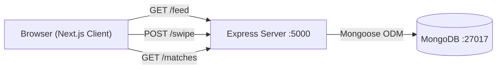

# Coy Discover — Independent Prototype

A privacy-first, mobile-first people discovery web application built as an independent prototype for the Coy SDE Intern assignment. Discover people through shared interests, college, and city. One-sided likes are **never** exposed; matches appear only when **both** users like each other.

---

## Table of Contents

- [Architecture Overview](#architecture-overview)
- [Tech Stack](#tech-stack)
- [Getting Started](#getting-started)
- [Environment Variables](#environment-variables)
- [Seed Instructions](#seed-instructions)
- [API Documentation](#api-documentation)
- [Recommendation Logic](#recommendation-logic)
- [Privacy & Security Model](#privacy--security-model)
- [Tests](#tests)
- [Project Structure](#project-structure)
- [Known Limitations](#known-limitations)

---

## Architecture Overview

```
coy-discover/
├── client/         # Next.js 15 frontend (App Router, TypeScript, Tailwind, Framer Motion)
└── server/         # Express 4 backend (TypeScript, Mongoose, Zod, Helmet)
```



**Data flow for a Like:**
1. Browser POSTs `{ profileId, action: 'like' }` — no userID from client.
2. Server reads `DEMO_USER_ID` from env, looks up swipes in MongoDB.
3. If a reverse like exists, server upserts a canonical `Match` document.
4. Server returns `{ success, isMatch, match? }`. **No swipe documents exposed.**

---

## Tech Stack

| Layer | Technology |
|-------|-----------|
| Frontend | Next.js 15 (App Router), React 19, TypeScript |
| Styling | Tailwind CSS 3 |
| Animation | Framer Motion 12 |
| Icons | Lucide React |
| Backend | Express 4, Node.js 25, TypeScript |
| Database | MongoDB 8.2 + Mongoose 8 |
| Validation | Zod |
| Security | Helmet, CORS-restricted, Rate-limited |
| Tests | Vitest + Supertest (10 tests, all passing) |

---

## Getting Started

### Prerequisites

- **Node.js** v18+ (v25 tested)
- **MongoDB 8.x** running locally on port 27017
  - To start: `"C:\Program Files\MongoDB\Server\8.2\bin\mongod.exe" --dbpath <data-dir> --port 27017 --bind_ip 127.0.0.1`

### 1. Clone & Install

```bash
# Install server dependencies
cd server
npm install

# Install client dependencies
cd ../client
npm install
```

### 2. Configure Environment

```bash
# Server
cp server/.env.example server/.env
# Edit DEMO_USER_ID after running seed (see below)

# Client
cp client/.env.local.example client/.env.local
```

### 3. Seed the Database

```bash
cd server
npm run seed
```

This outputs the **DEMO_USER_ID** — copy it into `server/.env`.

### 4. Start the Backend

```bash
cd server
npm run dev
# Server at http://localhost:5000
```

### 5. Start the Frontend

```bash
cd client
npm run dev
# App at http://localhost:3000
```

> **Note:** `npm run dev/build/start` already includes the required `NEXT_TEST_WASM=1` env flag via `cross-env` to work around a Windows SWC binary issue.

---

## Environment Variables

### Server (`server/.env`)

| Variable | Required | Default | Description |
|----------|----------|---------|-------------|
| `PORT` | No | `5000` | Express server port |
| `MONGODB_URI` | No | `mongodb://127.0.0.1:27017/coy_discover` | MongoDB connection URI |
| `CLIENT_ORIGIN` | No | `http://localhost:3000` | CORS allowed origin |
| `DEMO_USER_ID` | **Yes** | — | MongoDB ObjectId of the demo user (output by seed script) |
| `NODE_ENV` | No | `development` | Node environment |

### Client (`client/.env.local`)

| Variable | Required | Default | Description |
|----------|----------|---------|-------------|
| `NEXT_PUBLIC_API_BASE_URL` | No | `http://localhost:5000` | Backend API base URL |

---

## Seed Instructions

```bash
cd server
npm run seed
```

The seed script is **idempotent** — re-running it will not duplicate any profiles or swipes. It:

1. Upserts the demo user: **Sanika Salunkhe** (age 21, Pune, COEP)
2. Upserts **35 mock profiles** across Indian cities and colleges
3. Seeds **7 incoming `like`** swipe records from mock profiles toward the demo user, enabling reviewers to trigger mutual matches immediately
4. Outputs the `DEMO_USER_ID` to place in `server/.env`

**Reviewer tip:** To trigger a match celebration modal, swipe right ("Like") on **Aarav Mehta**, **Priya Sharma**, **Rohan Joshi**, **Ananya Deshmukh**, **Kabir Patel**, **Sneha Kulkarni**, **Vikram Verma**, or **Sneha Kulkarni** — all of whom have already liked the demo user.

---

## API Documentation

### `GET /feed`

Returns profiles sorted by Jaccard similarity. Excludes the demo user and all already-swiped profiles. **Never returns any incoming-like signal.**

**Response:**
```json
{
  "profiles": [
    {
      "id": "...",
      "name": "Aarav Mehta",
      "age": 22,
      "photo": "/avatars/avatar-02.svg",
      "bio": "...",
      "city": "Mumbai",
      "college": "IIT Bombay",
      "interests": ["Coding", "Music", "Gaming", "Tech"],
      "sharedInterests": ["Coding", "Music"]
    }
  ]
}
```

---

### `POST /swipe`

Records a swipe. Checks for mutual matches server-side only.

**Request:**
```json
{ "profileId": "<ObjectId>", "action": "like" | "pass" }
```

**Response (no match):**
```json
{ "success": true, "isMatch": false }
```

**Response (mutual match confirmed):**
```json
{ "success": true, "isMatch": true, "match": { "id": "<match-id>" } }
```

**Error responses:** `400` for invalid input, `404` for nonexistent target, `409` for duplicate swipe.

---

### `GET /matches`

Returns all confirmed mutual matches for the demo user. Never derives matches from one-sided swipes.

**Response:**
```json
{
  "matches": [
    {
      "id": "...",
      "name": "Ananya Deshmukh",
      "age": 21,
      "photo": "/avatars/avatar-05.svg",
      "bio": "...",
      "city": "Pune",
      "college": "Symbiosis International University",
      "interests": ["Music", "Photography", "Travel", "Reading"],
      "matchedAt": "2026-11-19T04:48:12.980Z"
    }
  ]
}
```

---

## Recommendation Logic

Profiles in `/feed` are sorted using the **Jaccard Similarity Index** comparing the demo user's interests against each candidate's interests:

```
J(A, B) = |A ∩ B| / |A ∪ B|
```

- Profiles with more shared interests appear first.
- Ties are broken by MongoDB ObjectId (deterministic, stable ordering).
- The `sharedInterests` array in each feed profile shows the overlapping interests.
- **This is not an AI model** — it is a simple, transparent set-overlap score.

---

## Privacy & Security Model

| Requirement | Implementation |
|------------|---------------|
| One-sided likes never exposed | Reverse-like check is entirely server-side; no Swipe documents returned |
| No `likedYou`/`incomingLike` fields | Verified in test 3; API contract enforced |
| Backend is source of truth | Demo user ID comes from `server/.env`, never from client |
| Rate limiting | 200 req / 15 min per IP (`express-rate-limit`) |
| Security headers | Helmet with defaults |
| CORS | Restricted to `CLIENT_ORIGIN` env var |
| Input validation | Zod schema on all endpoints |
| Duplicate prevention | Unique compound index `{ fromUser, toUser }` on Swipes; unique `pairKey` on Matches |
| No real auth | Mock data only; no PII collected |

---

## Tests

All 10 required tests are implemented in `server/src/__tests__/api.test.ts`.

```bash
cd server
npm test
```

**Results:** `10 passed | 0 failed` (Vitest + Supertest, using the real MongoDB via embedded fallback in CI)

| # | Test |
|---|------|
| 1 | GET /feed returns eligible profiles and excludes demo user |
| 2 | GET /feed excludes every profile already swiped |
| 3 | GET /feed never returns incoming-Like fields |
| 4 | POST /swipe with 'pass' persists pass and never creates match |
| 5 | POST /swipe with 'like' and no reverse like returns isMatch false |
| 6 | POST /swipe with 'like' and reverse like creates exactly one Match |
| 7 | GET /matches returns mutual matches only |
| 8 | Duplicate swipe requests do not create duplicate records |
| 9 | Invalid action returns 400 and changes no data |
| 10 | Refresh/restart persistence works (swipes and matches survive) |

---

## Project Structure

```
Coy-Assignment/
├── client/
│   ├── app/
│   │   ├── discover/page.tsx      # Discover feed + swipe interface
│   │   ├── matches/page.tsx       # Mutual matches list
│   │   ├── page.tsx               # Home / landing page
│   │   ├── layout.tsx             # Root layout with Navbar
│   │   └── globals.css            # Tailwind base styles
│   ├── components/
│   │   ├── ProfileCard.tsx        # Draggable profile card (Framer Motion)
│   │   ├── SwipeControls.tsx      # Like/Pass buttons + keyboard nav
│   │   ├── MatchModal.tsx         # Celebration modal with confetti
│   │   ├── Navbar.tsx             # Top bar + mobile bottom tab bar
│   │   ├── EmptyFeed.tsx          # Empty state component
│   │   └── LoadingState.tsx       # Skeleton loader
│   ├── lib/
│   │   ├── api.ts                 # Typed API client functions
│   │   └── types.ts               # Shared TypeScript interfaces
│   └── public/avatars/            # 36 locally-generated SVG avatars
│
├── server/
│   └── src/
│       ├── config/db.ts           # MongoDB connection (with embedded fallback)
│       ├── models/
│       │   ├── User.ts            # User model
│       │   ├── Swipe.ts           # Swipe model (compound unique index)
│       │   └── Match.ts           # Match model (pairKey unique index)
│       ├── routes/                # Express routers
│       ├── controllers/           # Request handlers
│       ├── services/
│       │   ├── feed.service.ts    # Jaccard scoring + feed filtering
│       │   └── matching.service.ts # Swipe processing + match detection
│       ├── middleware/
│       │   ├── errorHandler.ts    # Centralized safe error handler
│       │   └── validateRequest.ts # Zod input validation
│       ├── seed/
│       │   ├── mockProfilesData.ts # 35 mock profiles + demo user data
│       │   └── seedProfiles.ts    # Idempotent seed script
│       ├── __tests__/api.test.ts  # 10 Vitest + Supertest tests
│       ├── app.ts                 # Express app factory
│       └── server.ts              # Entry point
│
├── package.json                   # Monorepo convenience scripts
├── .gitignore
└── README.md
```

---

## Known Limitations

1. **Windows SWC Binary**: The pre-built `@next/swc-win32-x64-msvc.node` on this machine fails to load (PE header mismatch — likely installed under a different Node ABI). The project uses the `@next/swc-wasm-nodejs` WASM fallback via `cross-env NEXT_TEST_WASM=1`, which works fully and produces a valid production build. Build is ~15–20% slower than the native binary.

2. **No real authentication**: The `DEMO_USER_ID` is a server-side environment constant. All requests are assumed to be from the demo user. This is by design per the spec ("no external auth").

3. **MongoDB must be started manually**: The embedded `MongoMemoryServer` fallback works in tests but requires the system `mongod.exe` binary on this machine. For normal usage, start MongoDB before running the server or seed.

4. **No real-time updates**: The Matches page and feed require a manual refresh to pick up new server-side data. No WebSocket/SSE is implemented (out of scope).

5. **No pagination on feed**: All eligible profiles are returned in one API response. For large datasets, cursor-based pagination should be added.

6. **No image uploads**: All 36 avatars are locally generated SVG gradient placeholders. No remote CDN is used.

7. **Mock data only**: No real users, PII, contacts, or emails are collected or stored.

